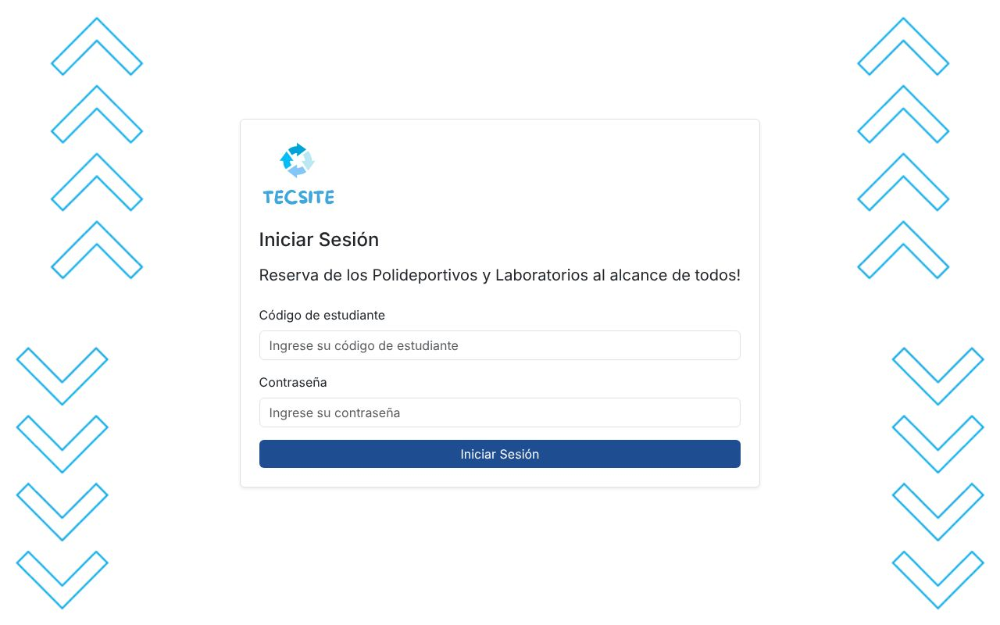
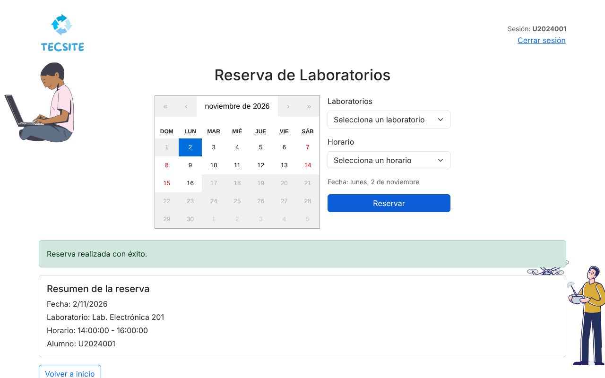

# Tecsite · Portal del alumno

Portal donde los alumnos de TECSUP reservan **laboratorios y polideportivos**. Tiene una API REST en **Spring Boot** y un frontend en **React**.

Es una de las dos partes del sistema Tecsite:

| Repo | Para quién | Stack |
|---|---|---|
| [tecs-admin](https://github.com/briansaa/tecs-admin) | Personal administrativo | Django REST + React |
| **tecs-cliente** (este) | Alumnos | Spring Boot + React |

Las dos apps comparten la base de datos MySQL `tecsite`. Las tablas las crean las migraciones de Django en `tecs-admin`.

| Login | Reserva |
|---|---|
|  |  |

## Funcionalidades

- Login con código de alumno. Las contraseñas se verifican con **BCrypt**, compatible con los hashes que genera `tecs-admin`.
- Las contraseñas antiguas en texto plano se convierten a hash en el primer login.
- Las rutas están protegidas: hay que iniciar sesión para reservar, y la reserva queda a nombre del alumno logueado.
- Reserva de laboratorios y polideportivos en un calendario de 14 días.
- **Validaciones en la API:**
  - no se puede reservar en fechas pasadas;
  - si el espacio ya está reservado en esa fecha y horario, la API responde `409 Conflict` con un mensaje.
- La API nunca devuelve contraseñas.

## Stack

| Capa | Tecnología |
|---|---|
| API | Java 17, Spring Boot 2.7 (Web, Data JPA), spring-security-crypto |
| Base de datos | MySQL / MariaDB. Los tests usan H2 |
| Tests | JUnit 5 + MockMvc (6 tests de integración) |
| Frontend | React 18, React Router 6, Axios, Bootstrap 5, react-calendar |
| CI | GitHub Actions (tests de Maven y build de React) |

## Cómo correrlo

Primero levanta `tecs-admin` y ejecuta sus migraciones. Ese paso crea las tablas y el usuario de prueba `U2024001 / demo1234`.

### 1. API (Spring Boot)

```bash
export DB_PASSWORD=tu_password   # ver .env.example para el resto de variables
./mvnw spring-boot:run           # http://localhost:8090
```

### 2. Portal (React)

```bash
cd cliente-frontend
npm install
npm start                        # http://localhost:3000
```

Si la API corre en otra URL, define `REACT_APP_API_URL` en `cliente-frontend/.env`.

### Tests

```bash
./mvnw test                      # usa H2 en memoria, no necesita MySQL
```

## Endpoints principales

| Método | Ruta | Descripción |
|---|---|---|
| POST | `/clientes/login` | Login: devuelve `{ id, codigo }` o `401` |
| GET | `/laboratorios/getAll` · `/polideportivos/getAll` · `/horarios/getAll` | Catálogos |
| POST | `/reservalaboratorio/store` | Reservar laboratorio (`201`, `400` o `409`) |
| POST | `/reservapolideportivo/store` | Reservar polideportivo (`201`, `400` o `409`) |

## Autor

**[Brian Saavedra](https://github.com/briansaa)**. Proyecto académico de TECSUP.
